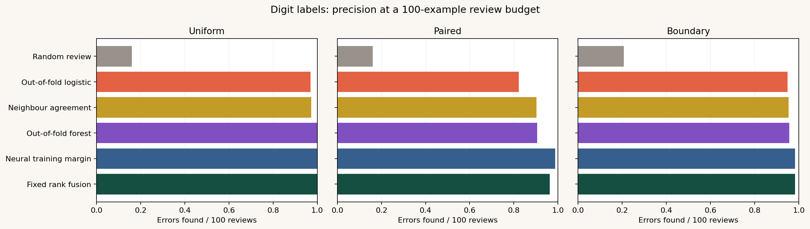

# DataClinic

**Which training labels are worth reviewing when review time is limited?**

DataClinic compares six ways of ranking suspicious examples. A simulated reviewer checks the top 25, 50, 100, or 200 examples and corrects only the labels that were changed by the experiment. The model is then retrained, and its accuracy on untouched test data is measured. The main result is the trade-off between errors found and improvement after review.

[Open the standalone review page](docs/index.html) · [Read the completed results](results/main/RESULTS.md) · [Read the method](docs/METHOD.md)



The [detection-versus-accuracy chart](results/main/detection_vs_accuracy.png) shows why ranking success alone is not the final result.

## Key results

Across five paired runs on the digit dataset's difficult-case condition, fixed rank fusion found injected errors in **90.4% of its first 25 reviews** at a 5% overall error rate. Random review found **7.2%**. After correcting the reviewed labels and retraining logistic regression, the average test-accuracy changes were **+0.76** and **+0.13 percentage points**, respectively.

Error detection is not the same as model improvement. At 20% random noise on digits, fusion found an injected error in every one of its first 100 reviews but raised logistic test accuracy by only **0.09 points**; neighbour review found errors in 97.2% and raised it by **1.38 points**. Small changes vary across seeds and models. The complete per-run data, including negative changes, are in [the results](results/main/RESULTS.md).

## What is in the repository

| Path | Contents |
|---|---|
| `src/dataclinic/` | Dataset preparation, controlled corruption, review methods, evaluation, reporting, and CLI |
| `configs/` | Fixed full-run and quick-check configurations |
| `results/main/` | Completed experiment rows, summaries, figures, and example queue |
| `docs/index.html` | Self-contained interactive review page built from those results |
| `demo/template.html` | Source template for the page |
| `tests/` | Data integrity and end-to-end checks |

The Python files under `src/dataclinic/` are the complete project source. The HTML page and tables are derived outputs; changing the methods and running the command below rebuilds them.

An [optional human-annotation benchmark](docs/HUMAN_LABELS.md) adds a separate CIFAR-10N evaluation path. Its source, configuration, and data-order checks are included; its results are **not** part of the completed figures because the official external dataset is not bundled or run here.

## Reproduce the project

Use Python 3.11 or newer. Python 3.12 and the versions in `requirements-reproduce.txt` generated the committed results. From the repository root:

```bash
python -m venv .venv
# Windows PowerShell: .venv\Scripts\Activate.ps1
# macOS/Linux: source .venv/bin/activate
python -m pip install -r requirements-reproduce.txt
python -m pip install -e . --no-deps
python -m unittest discover -s tests -v
python -m dataclinic reproduce --config configs/reproduce.json --output results/main --docs docs
python -m dataclinic audit --output results/main --docs docs
node tests/check_demo.cjs docs/index.html  # Optional demo interaction check
```

For a short pipeline check before the full run:

```bash
python -m dataclinic reproduce --config configs/smoke.json --output results/tmp --docs docs
```

The short check rewrites `docs/index.html` with incomplete results. Run the full command afterwards to restore the complete page. Open `docs/index.html` in a browser without a server. To publish it from GitHub, configure Pages to serve the `/docs` folder on the default branch, if Pages is available for the repository.

**Uploading to GitHub:** extract the project archive, then commit the *contents* of the `DataClinic` folder to a repository. Keep `src/`, `configs/`, `tests/`, `demo/`, `docs/`, `results/main/`, the root project files, and `.github/`. Do not upload only the ZIP or only the HTML page as the repository code. GitHub Desktop can create a repository from the extracted folder and push it; `.gitignore` leaves temporary output and local environments out of the commit.

## Experiment at a glance

The benchmark uses handwritten digits as its main dataset and a small tabular diagnostic dataset as a cross-check. Both ship with scikit-learn; the reproduction command makes no data download. It adds exactly 5% or 20% incorrect *training* labels under three fixed conditions: random flips, class-specific flips, and flips on difficult examples near another class. The test set is split off first and kept clean. The rarer-error setting tests whether strong results at 20% survive when most review candidates are correct.

The methods are random review; out-of-fold logistic and forest disagreement with the recorded label; leave-one-out neighbour disagreement; a compact neural network's training margins across epochs; and a fixed equal-weight fusion of three rankings. The training-dynamics score is an adaptation, **not** a claim to implement the published AUM procedure. A hindsight oracle gives an error-detection ceiling but is unavailable to a real reviewer. It need not maximise accuracy after retraining.

All methods use the same splits, noise seeds, budgets, and outcome models. The main outcome model is logistic regression; a random forest checks whether the finding depends on that choice at a 100-review budget. Five paired seeds are recorded, including individual run rows. See [the protocol](docs/METHOD.md) and [the results](results/main/RESULTS.md) before interpreting any headline number.

## Scope

The introduced errors have known answers, which makes ranking measurable. Naturally bad labels may behave differently. A high error-detection score can coexist with little or negative test improvement. This is an experiment about review prioritisation, not a tool for automatically changing labels or making clinical decisions.

## References

- Northcutt, Jiang, Chuang. [Confident Learning: Estimating Uncertainty in Dataset Labels](https://www.jair.org/index.php/jair/article/view/12125), JAIR 2021.
- Pleiss et al. [Identifying Mislabeled Data using the Area Under the Margin Ranking](https://proceedings.neurips.cc/paper/2020/hash/c6102b3727b2a7d8b1bb6981147081ef-Abstract.html), NeurIPS 2020.
- Swayamdipta et al. [Dataset Cartography: Mapping and Diagnosing Datasets with Training Dynamics](https://aclanthology.org/2020.emnlp-main.746/), EMNLP 2020.
- [scikit-learn dataset documentation](https://scikit-learn.org/stable/datasets/toy_dataset.html).

The code and demo in this repository are an independent implementation. The cited methods motivated the comparisons; see the protocol for the exact algorithms implemented here.

